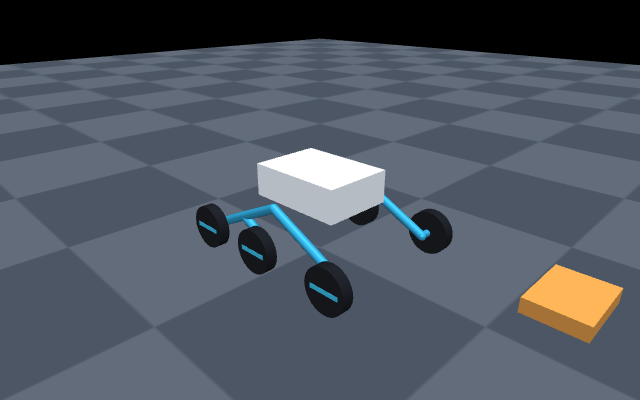
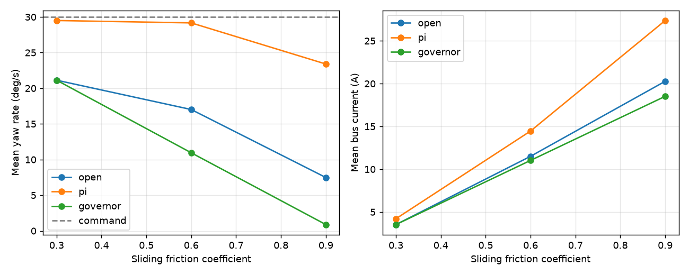

# Rover drivebase simulation




A MuJoCo sim of a six-wheel rocker-bogie rover: wheel speed control over a delayed CAN link, the suspension moving over obstacles, and the battery and motor limits that cap what the wheels can do.

- 14 scenarios in all: straight driving, an obstacle, locked wheels, lost commands and turning.
- The straight run covers about 1.8 m with CAN delay in the loop.
- Climbing the box with the left wheels swings the bogie about 15 degrees.
- Yaw PI holds a turn at about 29 deg/s at the default friction.
- Locked wheels are the hard case. All the motors share one battery and their torque limit moves with voltage, so the bus current peaks around 36.5 A.
- If commands stop mid-drive, every driver watchdog latches at about 2.2 s.

Full numbers are in [docs/RESULTS.md](docs/RESULTS.md), and the equations and datasheet values are in [docs/PARAMETERS.md](docs/PARAMETERS.md).

## Run it

You need Python and `requirements.txt`. From the project folder:

```sh
python viz/build_rover.py
python -m pytest tests -q -p no:cacheprovider
python -m experiments.run_all
python -m experiments.check_results
python viz/preview_rover.py
```

That rebuilds the scene, runs the tests and trials, checks the saved data and renders the obstacle replay.

License: [MIT](LICENSE).
