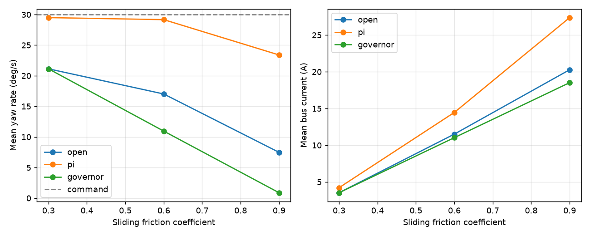

# Results

I regenerate these trials with `python -m experiments.run_all`.

Yaw is the mean body gyro z over the final steady window. Current and
voltage summarize the entire recorded trial, excluding settling.

| Case | Yaw (deg/s) | Forward displacement (m) | Min bus (V) | Peak bus (A) | Faults |
|---|---:|---:|---:|---:|---:|
| straight | 0.000 | 1.794 | 25.065 | 3.366 | 0 |
| obstacle | 0.000 | 1.655 | 24.573 | 15.666 | 0 |
| stall | -0.000 | 0.000 | 23.739 | 36.516 | 0 |
| watchdog | -0.000 | 1.358 | 25.065 | 3.366 | 6 |
| turn_trip | 0.171 | 1.379 | 24.341 | 21.465 | 2 |
| turn_0.3_open | 21.131 | -0.088 | 25.024 | 4.398 | 0 |
| turn_0.3_pi | 29.501 | -0.098 | 24.246 | 23.851 | 0 |
| turn_0.3_governor | 21.131 | -0.088 | 25.024 | 4.398 | 0 |
| turn_0.6_open | 17.018 | -0.103 | 24.557 | 16.074 | 0 |
| turn_0.6_pi | 29.168 | -0.094 | 24.243 | 23.928 | 0 |
| turn_0.6_governor | 10.950 | -0.091 | 24.610 | 14.738 | 0 |
| turn_0.9_open | 7.482 | -0.176 | 24.190 | 25.247 | 0 |
| turn_0.9_pi | 23.397 | -0.206 | 23.704 | 37.390 | 0 |
| turn_0.9_governor | 0.882 | -0.029 | 24.294 | 22.653 | 0 |

Each JSON summary has a matching NPZ trace. Electrical columns are time_s,
bus_voltage_V, bus_current_A, six torques_Nm, six speeds_rad_s, six
requested_torques_Nm and six status codes, in lf/lm/lr/rf/rm/rr order.
Physics arrays contain the full generalized pose and velocity, body gyro
and summed world vertical contact force on each wheel.

I place the obstacle under the left wheel path and lock wheel joints
for the stall trial. The watchdog trial stops commands during motion.
Trips latch on raw PI current requests; continuous limiting clips torque.

Stall current follows the empirical motor fit, with unequal SI torque
and back-emf constants. Contact uses rigid cylinders and compliant
friction. See [Parameters](PARAMETERS.md) for equations and settings.

